# Lab 03 — FRR and OSPF

Build OSPF adjacencies, inspect the LSDB, and see routes installed from FRR into the Linux FIB.

## Topology

```text
r1 ---- r2 ---- r3
1.1.1.1  2.2.2.2  3.3.3.3
```

## Packet path

<picture>
  <source media="(prefers-color-scheme: dark)" srcset="packet-path.dark.svg">
  
</picture>

## Run

```bash
sudo containerlab deploy -t lab.clab.yml
sudo containerlab destroy -t lab.clab.yml
```

## Explore

- Inspect neighbor state transitions and protocol 89 traffic.
- Bounce a link and capture DD, LS-Request, LS-Update and LS-Ack.
- Compare `show ip route ospf` with Linux `ip route`.

## Useful checks

- `docker exec clab-pp03-r1 vtysh -c "show ip ospf neighbor"`
- `docker exec clab-pp03-r1 vtysh -c "show ip route ospf"`


