# Lab 06 — BGP Local Preference and MED

Compare two major BGP policy attributes. Local Preference is internal policy; MED is a hint from the neighboring AS.

## Topology

```text
up1(AS65100) --eBGP-- edge1(AS65000) ==iBGP== edge2(AS65000) --eBGP-- up2(AS65100)

up1 -> edge1: announces 203.0.113.0/24 with outbound MED 50
up2 -> edge2: announces 203.0.113.0/24 with outbound MED 200
```

## Packet path

<picture>
  <source media="(prefers-color-scheme: dark)" srcset="packet-path.dark.svg">
  
</picture>

## Run

```bash
sudo containerlab deploy -t lab.clab.yml
sudo containerlab destroy -t lab.clab.yml
```

## Explore

- Observe that Local Preference wins before MED in best-path selection.
- Remove the inbound Local Preference policy and compare MED 50 vs 200.
- Change attributes and use `show bgp ...` to explain every best-path decision.

## Useful checks

- `docker exec clab-pp06-edge1 vtysh -c "show bgp ipv4 unicast 203.0.113.0/24"`
- `docker exec clab-pp06-edge2 vtysh -c "show bgp ipv4 unicast 203.0.113.0/24"`

