# Lab 07 — BGP Communities

Tag routes with BGP communities and apply policy to the tags instead of hard-coding every prefix.

## Topology

```text
r1 AS65001 ---- r2 AS65002 ---- r3 AS65003
```

## Packet path

<picture>
  <source media="(prefers-color-scheme: dark)" srcset="packet-path.dark.svg">
  
</picture>

## Run

```bash
sudo containerlab deploy -t lab.clab.yml
sudo containerlab destroy -t lab.clab.yml
```

## Explore

- R1 tags two prefixes with different communities.
- R2 exports only the `65001:100` community toward R3.
- Change the community-list and watch policy scale independently of prefix count.

## Useful checks

- `docker exec clab-pp07-r2 vtysh -c "show bgp ipv4 unicast community"`
- `docker exec clab-pp07-r3 vtysh -c "show bgp ipv4 unicast"`


