# Lab 10 — OSPF Cost

Influence SPF by changing interface cost instead of changing physical topology.

## Topology

```text
      r2
 10 /  \
r1        r4
 50 \  /
      r3
```

## Packet path

<picture>
  <source media="(prefers-color-scheme: dark)" srcset="packet-path.dark.svg">
  
</picture>

## Run

```bash
sudo containerlab deploy -t lab.clab.yml
sudo containerlab destroy -t lab.clab.yml
```

## Explore

- Confirm R1 prefers the low-cost upper path.
- Change the costs live and watch the route move.
- Make costs equal and observe ECMP.

## Useful checks

- `docker exec clab-pp10-r1 vtysh -c "show ip ospf interface"`
- `docker exec clab-pp10-r1 vtysh -c "show ip route 4.4.4.4/32"`


