# Lab 13 — VRF

Place two identical address spaces in separate Linux VRFs and see how independent routing tables remove the conflict.

## Topology

```text
blue 10.0.0.0/24 -- r1[VRF blue | VRF red] -- 10.0.0.0/24 red
```

## Packet path

<picture>
  <source media="(prefers-color-scheme: dark)" srcset="packet-path.dark.svg">
  
</picture>

## Run

```bash
sudo containerlab deploy -t lab.clab.yml
sudo containerlab destroy -t lab.clab.yml
```

## Explore

- Inspect routing table 100 and 200.
- Use `ip vrf exec` to generate traffic from a selected VRF.
- Try route leaking between the VRFs as an extension.

## Useful checks

- `docker exec clab-pp13-r1 ip vrf show`
- `docker exec clab-pp13-r1 ip route show table 100`
- `docker exec clab-pp13-r1 ip route show table 200`


