# Lab 14 — VXLAN Basics

Stretch one L2 segment over an L3 underlay using two Linux VTEPs and VXLAN VNI 100.

## Topology

```text
h1 -- vtep1 ===== UDP/4789 ===== vtep2 -- h2
      192.0.2.1            192.0.2.2
```

## Packet path

<picture>
  <source media="(prefers-color-scheme: dark)" srcset="packet-path.dark.svg">
  
</picture>

## Run

```bash
sudo containerlab deploy -t lab.clab.yml
sudo containerlab destroy -t lab.clab.yml
```

## Explore

- Capture outer UDP/4789 and inner Ethernet/ARP/ICMP.
- Inspect VXLAN device details with `ip -d link`.
- Change VNI on one side and explain the failure.

## Useful checks

- `docker exec clab-pp14-vtep1 ip -d link show vxlan100`
- `docker exec clab-pp14-h1 ping -c 2 10.10.10.2`


