# Lab 16 — BGP EVPN + VXLAN

Replace static VXLAN flood-and-learn control with BGP EVPN MAC/IP route exchange.

## Topology

```text
h1 -- leaf1 ===== BGP EVPN / VXLAN ===== leaf2 -- h2
```

## Packet path

<picture>
  <source media="(prefers-color-scheme: dark)" srcset="packet-path.dark.svg">
  
</picture>

## Run

```bash
sudo containerlab deploy -t lab.clab.yml
sudo containerlab destroy -t lab.clab.yml
```

## Explore

- Inspect EVPN route types and VNI state.
- Compare bridge FDB entries before and after traffic.
- Capture BGP control-plane traffic and VXLAN data-plane traffic separately.

## Useful checks

- `docker exec clab-pp16-leaf1 vtysh -c "show bgp l2vpn evpn"`
- `docker exec clab-pp16-leaf1 vtysh -c "show evpn vni"`


