# Lab 17 — iBGP Route Reflector

Remove the iBGP full-mesh requirement by reflecting routes through one RR.

## Topology

```text
r1 \
     RR -- r2
    /
  r3
```

## Packet path

<picture>
  <source media="(prefers-color-scheme: dark)" srcset="packet-path.dark.svg">
  
</picture>

## Run

```bash
sudo containerlab deploy -t lab.clab.yml
sudo containerlab destroy -t lab.clab.yml
```

## Explore

- Verify clients learn each other’s loopbacks without direct BGP sessions.
- Inspect ORIGINATOR_ID and CLUSTER_LIST attributes.
- Remove `route-reflector-client` and observe the iBGP split-horizon rule.

## Useful checks

- `docker exec clab-pp17-rr vtysh -c "show bgp ipv4 unicast summary"`
- `docker exec clab-pp17-r1 vtysh -c "show bgp ipv4 unicast"`


