# Lab 18 — iBGP + eBGP Together

Use OSPF as the internal reachability layer, iBGP between edge loopbacks, and eBGP toward two external ASes.

## Topology

```text
ISP1 -- edge1 -- core -- edge2 -- ISP2
          \____ iBGP ____/
```

## Packet path

<picture>
  <source media="(prefers-color-scheme: dark)" srcset="packet-path.dark.svg">
  
</picture>

## Run

```bash
sudo containerlab deploy -t lab.clab.yml
sudo containerlab destroy -t lab.clab.yml
```

## Explore

- See why iBGP peers are commonly built over loopbacks.
- Compare IGP next-hop reachability with BGP route selection.
- Remove `next-hop-self` and troubleshoot unreachable BGP next hops.

## Useful checks

- `docker exec clab-pp18-edge1 vtysh -c "show ip route ospf"`
- `docker exec clab-pp18-edge1 vtysh -c "show bgp ipv4 unicast"`


