# Lab 19 — BFD

Use Bidirectional Forwarding Detection to detect forwarding failure much faster than normal routing-protocol timers.

## Topology

```text
r1 AS65001 ===== BFD + eBGP ===== r2 AS65002
```

## Packet path

<picture>
  <source media="(prefers-color-scheme: dark)" srcset="packet-path.dark.svg">
  
</picture>

## Run

```bash
sudo containerlab deploy -t lab.clab.yml
sudo containerlab destroy -t lab.clab.yml
```

## Explore

- Inspect BFD session state and negotiated timers.
- Shut one interface and measure BGP teardown time.
- Disable BFD and compare convergence.

## Useful checks

- `docker exec clab-pp19-r1 vtysh -c "show bfd peers"`
- `docker exec clab-pp19-r1 vtysh -c "show bgp summary"`


