# Lab 23 — ICMP TTL and Traceroute

Demystify traceroute by forcing packets to expire one hop at a time and observing ICMP Time Exceeded replies.

## Topology

```text
h1 -- r1 -- r2 -- h2
```

## Packet path

<picture>
  <source media="(prefers-color-scheme: dark)" srcset="packet-path.dark.svg">
  
</picture>

## Run

```bash
sudo containerlab deploy -t lab.clab.yml
sudo containerlab destroy -t lab.clab.yml
```

## Explore

- Run traceroute and capture ICMP on each router.
- Send pings with TTL 1, 2 and 3.
- Explain exactly which device generates each Time Exceeded message.

## Useful checks

- `docker exec clab-pp23-h1 traceroute -n 10.0.2.2`
- `docker exec clab-pp23-h1 ping -t 1 -c 1 10.0.2.2`


