# Lab 26 — BGP for IPv6

Use the IPv6 unicast address family and follow AS_PATH and next-hop behavior with IPv6 NLRI.

## Topology

```text
AS65001 r1 ==== AS65002 r2 ==== AS65003 r3
```

## Packet path

<picture>
  <source media="(prefers-color-scheme: dark)" srcset="packet-path.dark.svg">
  
</picture>

## Run

```bash
sudo containerlab deploy -t lab.clab.yml
sudo containerlab destroy -t lab.clab.yml
```

## Explore

- Inspect the IPv6 BGP table on R1.
- Capture TCP/179 over IPv6.
- Compare commands and attributes with Lab 04.

## Useful checks

- `docker exec clab-pp26-r1 vtysh -c "show bgp ipv6 unicast summary"`
- `docker exec clab-pp26-r1 vtysh -c "show bgp ipv6 unicast"`


