# Lab 28 — eBGP Leaf-Spine Underlay

Build a Clos-style IP fabric with two spines and four leaves using eBGP and redundant equal-cost paths.

## Topology

```text
        spine1     spine2
       / / | \   / | \ \
     leaf1 leaf2 leaf3 leaf4
```

## Packet path

<picture>
  <source media="(prefers-color-scheme: dark)" srcset="packet-path.dark.svg">
  
</picture>

## Run

```bash
sudo containerlab deploy -t lab.clab.yml
sudo containerlab destroy -t lab.clab.yml
```

## Explore

- Inspect each leaf’s two eBGP sessions.
- Verify reachability between leaf-advertised /24 prefixes.
- Enable/inspect multipath and fail one spine link.

## Useful checks

- `docker exec clab-pp28-leaf1 vtysh -c "show bgp ipv4 unicast summary"`
- `docker exec clab-pp28-leaf1 vtysh -c "show bgp ipv4 unicast"`


